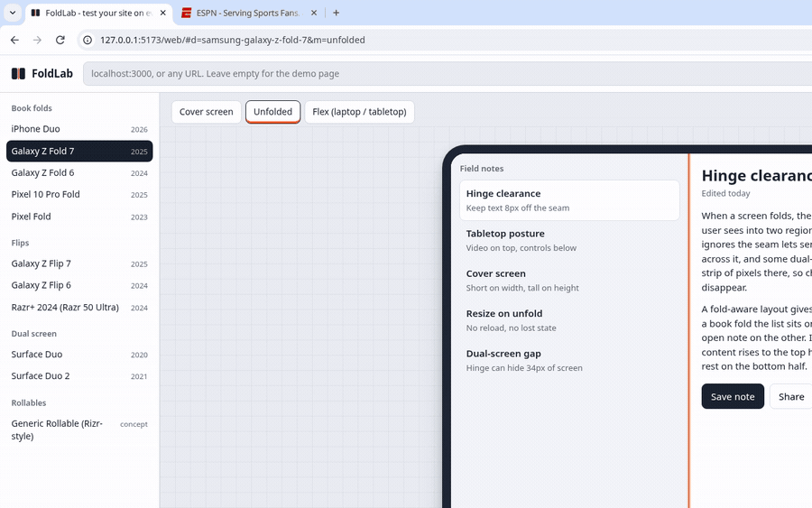

# FoldLab

**DevTools for foldables.** Load your site, then fold, unfold, rotate and half-fold it on a Galaxy Z Fold, Pixel Fold, Surface Duo, iPhone Duo, flips and rollables, with a real hinge, viewport segments and device posture.



Most apps and sites still treat a foldable like a big phone. The text runs straight through the hinge, the layout never reacts to half-folded posture, and nobody notices until a user on a $1,800 device does. Chrome DevTools has a handful of foldable presets, but no live fold/unfold, no hinge you can see, and no way to compare devices side by side. FoldLab fills that gap.

## Two ways to use it

| | Web playground | Chrome extension |
|---|---|---|
| Install | none, open the page | load unpacked (below) |
| Works on | pages that allow framing, plus your own pages with `foldlab-client.js` | **any** page, including `localhost` and sites that block framing |
| Hinge and posture | simulated for your page via `foldlab-client.js` | **real** Chrome emulation (`displayFeature`, device posture, hinge overlay) |
| Native `@media (horizontal-viewport-segments: 2)` | no (use the CSS variables below) | yes, if your Chrome build exposes it (see Troubleshooting) |
| All-devices grid | yes | yes (opens the playground, with framing limits lifted for that one tab) |

## Quick start

```bash
git clone https://github.com/<you>/foldlab && cd foldlab
npm install        # only needed to run the tests
npm start          # http://localhost:5173/web/
```

Open the playground, paste a URL (or leave it empty for the demo page), pick a device and press **Unfold**. Links are shareable: the device, state and URL live in the hash.

> A playground served over `https://` cannot frame `http://localhost` pages (mixed content). Use the extension for local development, or run the playground locally with `npm start`.

### Chrome extension

1. Run `npm run sync` once (the repo already includes a synced copy).
2. Open `chrome://extensions`, turn on **Developer mode**, choose **Load unpacked**, and select the `extension/` folder.
3. Open any web page, click the FoldLab icon, pick a device and a state.

Chrome shows a "FoldLab started debugging this browser" bar while emulation is on. That is Chrome being transparent: FoldLab uses the same debugging protocol as DevTools. Closing the bar stops emulation.

To build a zip for the Chrome Web Store: `npm run build:extension` (writes `dist/foldlab-extension.zip`).

## Make your page fold-aware

Add the client script to any page you are testing (development only):

```html
<script src="https://cdn.jsdelivr.net/gh/<you>/foldlab/web/foldlab-client.js"></script>
```

Then use whichever interface fits your stack:

```css
/* 1. CSS variables and data attributes on <html> */
html[data-fold-segments="2"][data-fold-orientation="vertical"] .app {
  display: grid;
  grid-template-columns: var(--fold-seg0-w) var(--fold-hinge-w) 1fr; /* list | hinge | detail */
}
html[data-fold-posture="folded"] .player { /* tabletop: video on top, controls below */ }
```

```js
// 2. JavaScript
foldlab.state;                       // { segments, posture, orientation, hinge, ... }
foldlab.onChange((s) => relayout(s));

// 3. The standard APIs, shimmed while simulating
matchMedia('(horizontal-viewport-segments: 2)').matches;
matchMedia('(device-posture: folded)').addEventListener('change', onPosture);
navigator.devicePosture.type;        // 'continuous' | 'folded'
visualViewport.segments;             // DOMRect-like segments, or null
```

| Variable | Meaning |
|---|---|
| `--fold-segments` | `1` or `2` |
| `--fold-orientation` | `vertical` (side by side), `horizontal` (stacked) or `none` |
| `--fold-posture` | `continuous` or `folded` |
| `--fold-seg0-x/y/w/h`, `--fold-seg1-...` | the usable regions, in CSS px |
| `--fold-hinge-x/y/w/h` | the hinge region (width or height is `0px` for seamless folds) |

`web/demo.html` is a complete example, including a "naive layout" toggle that shows what happens when you ignore the fold.

## Devices

| Type | Devices |
|---|---|
| Book folds | iPhone Duo, Galaxy Z Fold 7 and 6, Pixel 10 Pro Fold, Pixel Fold |
| Flips | Galaxy Z Flip 7 and 6, Razr+ 2024 (Razr 50 Ultra) |
| Dual screen | Surface Duo, Surface Duo 2 |
| Rollables | Generic Rizr-style concept (the screen grows taller, no hinge) |

Each device has a cover/closed state, an unfolded state, and (where it exists) a half-folded flex or tabletop state.

**How hinges are modelled.** Seamless folds (Fold, Flip, Razr, Pixel Fold, iPhone Duo) only get a physical hinge (and Chrome `displayFeature`) when half-folded, the same way Android's WindowManager reports a `FoldingFeature`. Flat modes still show a faint crease; in the playground that crease is exposed as a zero-width layout hinge so CSS can teach a two-pane fold-aware layout. Devices that physically hide pixels (Surface Duo) report a real hinge gap while spanned.

**Accuracy.** Panel pixel counts come from manufacturer spec sheets; CSS px are panel px divided by the device pixel ratio. Entries marked `approximate` use an estimated ratio or hinge size (for example, the iPhone Duo's logical size assumes 3x because Apple has not published it). Corrections are the most useful kind of pull request.

## Add or fix a device

Devices live in [`core/devices.json`](core/devices.json). Add an object, run `npm test` (it validates every profile), and open a PR.

```json
{
  "id": "vendor-model",
  "name": "Model name",
  "brand": "Vendor",
  "type": "book",
  "year": 2026,
  "modes": [
    { "id": "cover", "label": "Cover screen", "role": "closed", "width": 411, "height": 960, "dpr": 2.625, "posture": "folded" },
    { "id": "unfolded", "label": "Unfolded", "role": "open", "width": 750, "height": 832, "dpr": 2.625, "posture": "continuous", "crease": "vertical" },
    { "id": "flex", "label": "Flex", "width": 832, "height": 750, "dpr": 2.625, "posture": "folded",
      "hinge": { "orientation": "horizontal", "offset": "center", "length": 0 } }
  ]
}
```

`role: "closed" | "open"` marks the two states the **Fold/Unfold** button animates between. `hinge.offset` is CSS px from the top or left edge (or `"center"`); `hinge.length` is the CSS px of screen the hinge hides.

## How it works

`core/foldlab-core.js` holds the geometry (segments, rotation, interpolation) and maps a device state to Chrome DevTools Protocol commands:

- `Emulation.setDeviceMetricsOverride` with `displayFeature` sets the viewport and the hinge, which produces viewport segments.
- `Emulation.setDevicePostureOverride` sets `navigator.devicePosture`.
- `Overlay.setShowHinge` draws the hinge on the page.

Fold and unfold animations step the real viewport size, so your page reflows exactly as it would on the device.

```
core/        device profiles + geometry (zero dependencies, shared by everything)
web/         playground UI, demo page, foldlab-client.js
extension/   Manifest V3 extension (side panel + CDP emulation)
scripts/     dev server, extension sync + zip, icon generator
test/        node:test unit tests, plus jsdom tests for the UI and the extension panel
```

## Troubleshooting

- **"This Chrome build does not expose viewport segments to pages."** The viewport is emulated, but the web APIs for foldables are still rolling out and can depend on your Chrome version. Turn on `chrome://flags/#enable-experimental-web-platform-features`, restart Chrome, and try again. FoldLab's side panel checks what the page actually sees and tells you.
- **The playground shows a blank frame.** The site sends `X-Frame-Options` or a CSP that forbids framing. Use the extension.
- **Nothing happens on `chrome://` pages or the Web Store.** Chrome does not allow debugging them.
- **Native iOS and Android apps.** FoldLab tests websites and web apps. For native apps, use the Android Studio foldable emulators or Xcode previews.

## Privacy

FoldLab runs entirely in your browser. It has no server, no analytics and makes no network requests of its own. The extension requests `debugger` (emulation), `sidePanel`, `storage` (remembers your last device), and `declarativeNetRequest` plus host access, used only to lift framing restrictions inside the all-devices tab that the extension opens.

## Development

```bash
npm install
npm test           # 33 tests: geometry, device profiles, playground UI, client script, extension panel
npm run sync       # copy core/ and web/ into extension/playground/
```

## Roadmap

- Real-device frames and an animated hinge for the playground
- Screenshot and GIF export per device
- Record a session and replay it in CI (Playwright)
- Firefox and Safari tooling as foldable web APIs land

## License

MIT
